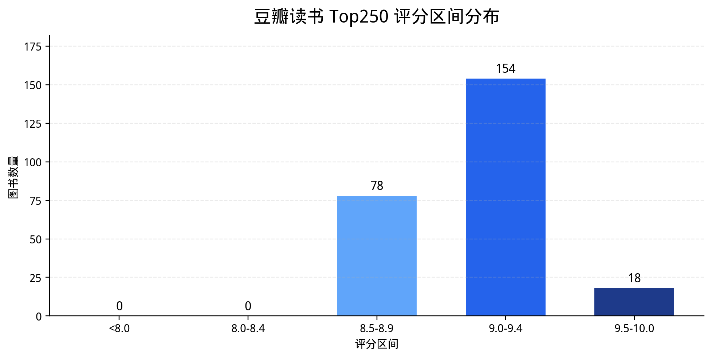
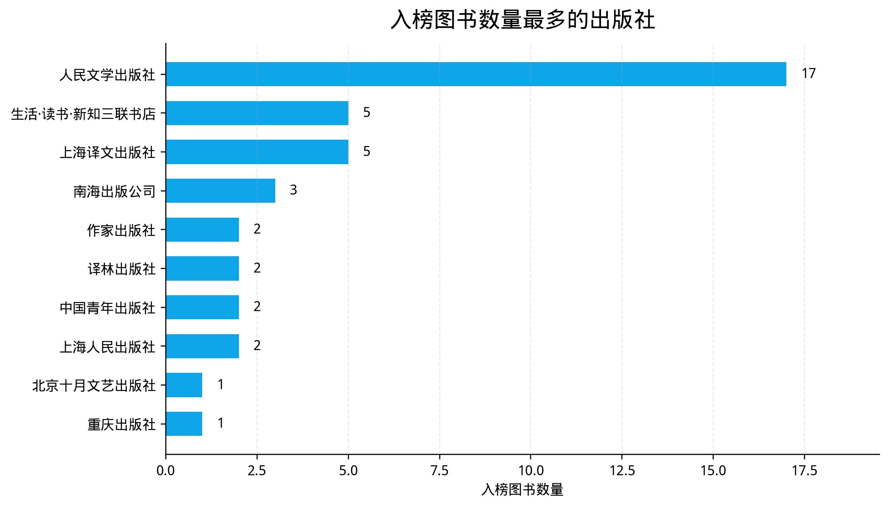
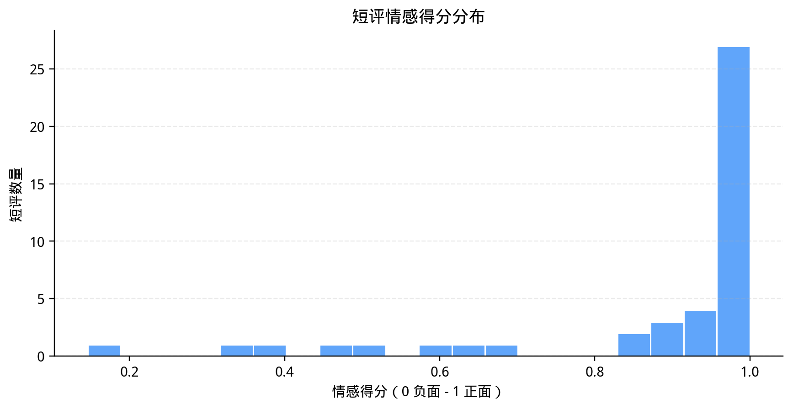

# 豆瓣读书 Top250 数据清洗与分析报告

- 生成时间：2026-11-16 06:36:36 UTC
- 原始数据：`data/raw_books.csv`
- 清洗数据：`data/clean_books.csv`

## 1. 数据质量

| 指标 | 数值 |
| --- | --- |
| 原始记录数 | 250 |
| 清洗后记录数 | 250 |
| 删除缺失标题记录 | 0 |
| 删除完全重复记录 | 0 |
| 删除重复书名记录 | 0 |
| 缺失评分填补 | 0 |
| 异常评分填补 | 0 |
| 缺失评价人数填补 | 0 |
| 异常评价人数填补 | 0 |

清洗规则：去除标题为空、完全重复和重复书名的记录；评分限制在 0-10；评价人数只保留数字并转成整数；评分和评价人数缺失或格式异常时使用中位数填补，同时在 `data_quality_flags` 字段中标记。

## 2. 总体统计

| 指标 | 数值 |
| --- | --- |
| 平均评分 | 9.07 |
| 评分中位数 | 9.10 |
| 评分范围 | 8.5 - 9.7 |
| 评价人数合计 | 25,020,847 |
| 评价人数中位数 | 57,861 |
| 评分与评价人数相关系数 | -0.074 |
| 图书价格中位数（元） | 35.00 |

## 3. 评分分布

| rating_band | book_count | share_pct |
| --- | --- | --- |
| <8.0 | 0 | 0.00% |
| 8.0-8.4 | 0 | 0.00% |
| 8.5-8.9 | 78 | 31.20% |
| 9.0-9.4 | 154 | 61.60% |
| 9.5-10.0 | 18 | 7.20% |

## 4. 评分最高的 10 本书

| rank | title | rating | rating_count | publisher |
| --- | --- | --- | --- | --- |
| 1 | 红楼梦 | 9.70 | 471495 | 人民文学出版社 |
| 3 | 哈利·波特 | 9.70 | 142273 | 人民文学出版社 |
| 66 | 南京大屠杀 | 9.70 | 31033 | 中信出版社 |
| 16 | 卡拉马佐夫兄弟 | 9.60 | 56911 | 上海译文出版社 |
| 68 | 毛泽东选集 | 9.60 | 40441 | 人民出版社 |
| 75 | 史记（全十册） | 9.60 | 28020 | 中华书局 |
| 223 | 坟 | 9.60 | 14681 | 人民文学出版社 |
| 5 | 三体全集 | 9.50 | 221529 | 重庆出版社 |
| 24 | 野草 | 9.50 | 57449 | 人民文学出版社 |
| 77 | 诗经 | 9.50 | 32561 | 北京出版社 |

## 5. 评价人数最多的 10 本书

| rank | title | rating | rating_count |
| --- | --- | --- | --- |
| 2 | 活着 | 9.40 | 930021 |
| 56 | 追风筝的人 | 8.90 | 831982 |
| 15 | 小王子 | 9.10 | 805394 |
| 246 | 解忧杂货店 | 8.50 | 789741 |
| 67 | 嫌疑人X的献身 | 8.90 | 561913 |
| 12 | 白夜行 | 9.20 | 546491 |
| 6 | 百年孤独 | 9.30 | 482431 |
| 1 | 红楼梦 | 9.70 | 471495 |
| 39 | 围城 | 9.00 | 464480 |
| 9 | 房思琪的初恋乐园 | 9.20 | 430417 |

## 6. 入榜图书最多的出版社

| publisher | 入榜图书数 |
| --- | --- |
| 人民文学出版社 | 38 |
| 上海译文出版社 | 23 |
| 生活·读书·新知三联书店 | 16 |
| 译林出版社 | 13 |
| 南海出版公司 | 12 |
| 广西师范大学出版社 | 10 |
| 北京十月文艺出版社 | 9 |
| 上海人民出版社 | 9 |
| 北京联合出版公司 | 6 |
| 新星出版社 | 6 |

## 7. 分析图表

## 8. 分析结论

- 清洗后共有 **250** 本图书，平均评分 **9.07**，评分中位数 **9.10**。
- 评分最高的是《红楼梦》，评价人数最多的是《活着》。
- 评分最集中的区间是 **9.0-9.4**，共有 **154** 本。
- 评分与评价人数的相关系数为 -0.074，两者相关性较弱。
- 入榜图书最多的出版社是 **人民文学出版社**；图书价格中位数为 **35.00** 元。

<!-- advanced-analysis:start -->
## 9. 高级分析

### 9.1 历史趋势

- 已记录快照：**2** 个
- 最新快照日期：**2026-11-16**
- 最新平均评分：**9.07**
- 最新评价人数合计：**25,020,847**

### 9.2 短评文本分析

- 有效短评：**160** 条
- 高频词：历史, 代表作, 生命, 一场, 社会, 文学, 爱情, 孩子, 探索, 不能
- 情感均值：**0.875**；正面占比 **89.4%**；负面占比 **5.0%**
- 主题关键词：北京、张郎、爱情、时期、完整、完美、核心、探索；生命、一场、不能、这么、整个、为了、灾难、为什么；孩子、他人、最深、历程、量子、教育、探索、困惑；监禁、最终、死亡、出卖、科幻小说、意义、绝唱、生与死；历史、代表作、文学、社会、时代、月亮、命运、一点

### 9.3 多维统计

- 入榜最多的国家/地区：**中国**
- 最常见的题材：**文学**
- 入榜最多的作者：**鲁迅**

### 9.4 相似高分书推荐

根据书名、作者、出版社、短评、国家和题材构建 TF-IDF 特征，并按余弦相似度推荐评分不低于 9.0 的图书。

| title | recommended_title | similarity | rating |
| --- | --- | --- | --- |
| 红楼梦 | 坟 | 0.13 | 9.60 |
| 红楼梦 | 围城 | 0.08 | 9.00 |
| 红楼梦 | 少年凯歌 | 0.07 | 9.30 |
| 红楼梦 | 彷徨 | 0.07 | 9.30 |
| 红楼梦 | 包法利夫人 | 0.07 | 9.10 |

<!-- advanced-analysis:end -->
