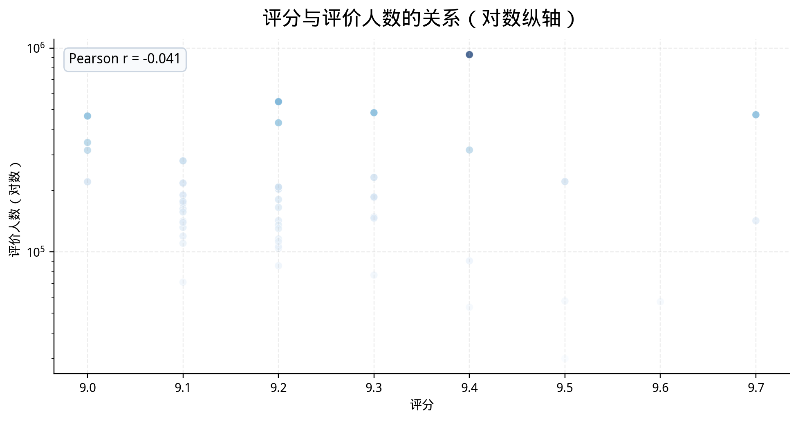
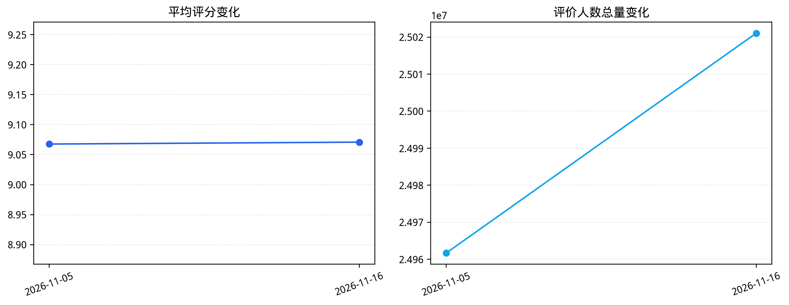
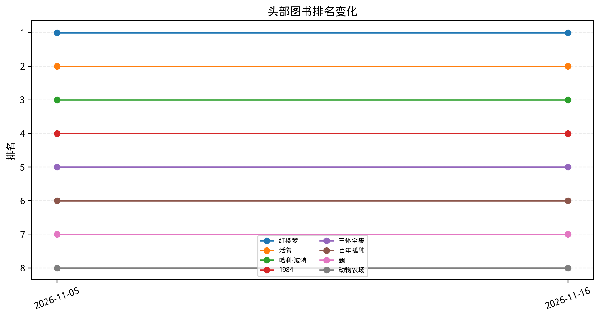
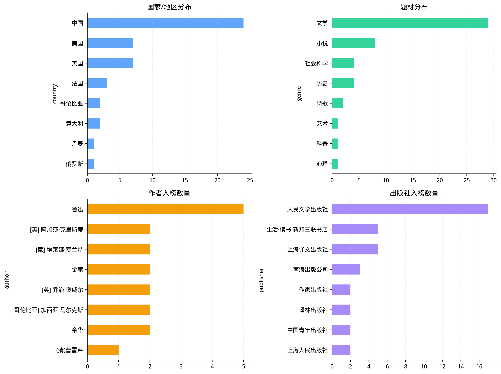

# 豆瓣读书 Top250 数据清洗与分析报告

- 生成时间：2026-11-16 09:04:08 UTC
- 原始数据：`data/raw_books.csv`
- 清洗数据：`data/clean_books.csv`

## 1. 数据质量

| 指标 | 数值 |
| --- | --- |
| 原始记录数 | 50 |
| 清洗后记录数 | 50 |
| 删除缺失标题记录 | 0 |
| 删除完全重复记录 | 0 |
| 删除重复书名记录 | 0 |
| 缺失评分填补 | 0 |
| 异常评分填补 | 0 |
| 缺失评价人数填补 | 0 |
| 异常评价人数填补 | 0 |

清洗规则：去除标题为空、完全重复和重复书名的记录；评分限制在 0-10；评价人数只保留数字并转成整数；评分和评价人数缺失或格式异常时使用中位数填补，同时在 `data_quality_flags` 字段中标记。

## 2. 总体统计

| 指标 | 数值 |
| --- | --- |
| 平均评分 | 9.23 |
| 评分中位数 | 9.20 |
| 评分范围 | 9.0 - 9.7 |
| 评价人数合计 | 10,926,320 |
| 评价人数中位数 | 163,974 |
| 评分与评价人数相关系数 | -0.041 |
| 图书价格中位数（元） | 36.00 |

## 3. 评分分布

| rating_band | book_count | share_pct |
| --- | --- | --- |
| <8.0 | 0 | 0.00% |
| 8.0-8.4 | 0 | 0.00% |
| 8.5-8.9 | 0 | 0.00% |
| 9.0-9.4 | 44 | 88.00% |
| 9.5-10.0 | 6 | 12.00% |

## 4. 评分最高的 10 本书

| rank | title | rating | rating_count | publisher |
| --- | --- | --- | --- | --- |
| 1 | 红楼梦 | 9.70 | 471506 | 人民文学出版社 |
| 3 | 哈利·波特 | 9.70 | 142280 | 人民文学出版社 |
| 16 | 卡拉马佐夫兄弟 | 9.60 | 56917 | 上海译文出版社 |
| 5 | 三体全集 | 9.50 | 221532 | 重庆出版社 |
| 24 | 野草 | 9.50 | 57449 | 人民文学出版社 |
| 49 | 艺术的故事 | 9.50 | 29958 | 广西美术出版社 |
| 2 | 活着 | 9.40 | 930034 | 作家出版社 |
| 4 | 1984 | 9.40 | 316506 | 北京十月文艺出版社 |
| 13 | 邓小平时代 | 9.40 | 90428 | 生活·读书·新知三联书店 |
| 43 | 故事新编 | 9.40 | 53506 | 人民文学出版社 |

## 5. 评价人数最多的 10 本书

| rank | title | rating | rating_count |
| --- | --- | --- | --- |
| 2 | 活着 | 9.40 | 930034 |
| 15 | 小王子 | 9.10 | 805399 |
| 12 | 白夜行 | 9.20 | 546504 |
| 6 | 百年孤独 | 9.30 | 482438 |
| 1 | 红楼梦 | 9.70 | 471506 |
| 39 | 围城 | 9.00 | 464483 |
| 9 | 房思琪的初恋乐园 | 9.20 | 430426 |
| 36 | 平凡的世界（全三部） | 9.00 | 344530 |
| 4 | 1984 | 9.40 | 316506 |
| 50 | 霍乱时期的爱情 | 9.00 | 315517 |

## 6. 入榜图书最多的出版社

| publisher | 入榜图书数 |
| --- | --- |
| 人民文学出版社 | 17 |
| 上海译文出版社 | 5 |
| 生活·读书·新知三联书店 | 5 |
| 南海出版公司 | 3 |
| 作家出版社 | 2 |
| 译林出版社 | 2 |
| 中国青年出版社 | 2 |
| 上海人民出版社 | 2 |
| 北京十月文艺出版社 | 1 |
| 重庆出版社 | 1 |

## 7. 分析图表

## 8. 分析结论

- 清洗后共有 **50** 本图书，平均评分 **9.23**，评分中位数 **9.20**。
- 评分最高的是《红楼梦》，评价人数最多的是《活着》。
- 评分最集中的区间是 **9.0-9.4**，共有 **44** 本。
- 评分与评价人数的相关系数为 -0.041，两者相关性较弱。
- 入榜图书最多的出版社是 **人民文学出版社**；图书价格中位数为 **36.00** 元。

<!-- advanced-analysis:start -->
## 9. 高级分析

### 9.1 历史趋势

- 已记录快照：**2** 个
- 最新快照日期：**2026-11-16**
- 最新平均评分：**9.23**
- 最新评价人数合计：**10,926,320**

### 9.2 短评文本分析

- 有效短评：**44** 条
- 高频词：社会, 出卖, 文学, 代表作, 爱情, 历史, 为了, 未来, 灵魂, 一点
- 情感均值：**0.876**；正面占比 **86.4%**；负面占比 **4.5%**
- 主题关键词：出卖、文学、东西、原则、遵循、良心、不能、从众；一点、未来、生与死、爱者、过去、野草、献于友、作证；社会、代表作、研究、传统、理论、结构、文化、乡土；历史、爱情、命运、变局、背后、个人、核心、义无反顾；灵魂、为了、生命、整个、低俗、提升、斗争、地位

### 9.3 多维统计

- 入榜最多的国家/地区：**中国**
- 最常见的题材：**文学**
- 入榜最多的作者：**鲁迅**

### 9.4 相似高分书推荐

根据书名、作者、出版社、短评、国家和题材构建 TF-IDF 特征，并按余弦相似度推荐评分不低于 9.0 的图书。

| title | recommended_title | similarity | rating |
| --- | --- | --- | --- |
| 红楼梦 | 围城 | 0.10 | 9.00 |
| 红楼梦 | 彷徨 | 0.08 | 9.30 |
| 红楼梦 | 三国演义（全二册） | 0.07 | 9.30 |
| 红楼梦 | 朝花夕拾 | 0.06 | 9.10 |
| 红楼梦 | 肖申克的救赎 | 0.06 | 9.10 |

<!-- advanced-analysis:end -->
