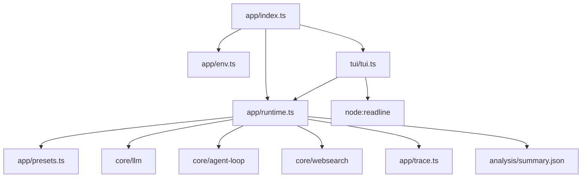

# TUI 模块说明

## 1. 模块定位

`src/app/tui` 实现聊天式终端 Agent 控制台。它负责：

1. 显示项目摘要和对话记录。
2. 接收用户任务和斜杠命令。
3. 调用 `AppRuntime` 执行 Agent、Web Search 或项目脚本。
4. 显示模型、工具 trace、最终回复和 Session 路径。

TUI 不直接实现爬虫、模型调用或搜索逻辑。

## 2. 文件结构

```text
src/app/
├── config.ts     # 环境变量与路径
├── env.ts        # .env 加载
├── index.ts      # 应用启动入口
├── presets.ts    # crawler / research Preset
├── prompt.ts     # Agent system prompt
├── runtime.ts    # Agent、Web Search、脚本和 Trace
├── trace.ts      # JSONL 运行追踪
└── tui/
    ├── index.ts  # 导出 Tui
    ├── tui.ts    # 聊天界面与键盘状态机
    ├── README.md # 使用说明
    └── tui.md    # 当前模块说明
```

## 3. 依赖关系



## 4. 启动流程

```text
npm run tui
  → clean dist + tsc
  → node dist/src/app/index.js
  → loadEnvFile()
  → new AppRuntime()
  → new Tui(runtime).start()
  → 读取 analysis/summary.json
  → 渲染聊天界面
```

## 5. 界面

| 区域 | 内容 |
| --- | --- |
| 顶部状态栏 | `provider/model · 状态 · 待处理数` |
| 帮助行 | `/help`、Esc、Ctrl+C |
| 会话区 | 用户消息、工具 trace、Agent 回复、本轮完成 |
| 输入行 | `> 当前输入█` |
| 底部状态 | 最近一次 Agent Session JSONL 路径 |

每次按键只更新输入行并重新绘制当前可见会话。

## 6. 输入与命令

普通文本：使用 `research` Preset 启动 Agent。

| 命令 | 动作 |
| --- | --- |
| `/help` | 显示帮助 |
| `/summary` | 刷新并显示数据摘要 |
| `/search <关键词>` | 直接执行 Web Search |
| `/trace` | 显示最新 trace 文件最近 20 行 |
| `/crawl` | 执行 `npm run crawl` |
| `/analyze` | 执行 `npm run analyze` |
| `/pipeline` | 执行 `npm run pipeline` |
| `/session` | 显示最近一次 Agent Session 路径 |
| `/clear` | 清空会话记录 |
| `/quit` | 退出 |

`Esc` 清空当前输入，`Ctrl+C` 退出。

## 7. Agent 执行流程

```text
用户输入
  → Tui.runAgent()
  → AppRuntime.runAgent()
  → selectProvider() 读取 .env 或环境变量
  → getAppPresetRegistry().get("research")
  → AgentLoop(provider, tools, preset.plugins, preset.systemPrompt)
  → tool/call / tool/result 事件
  → Tui 实时追加工具 trace
  → 最终回复
  → 本轮完成
```

状态栏会从 `provider: auto` 更新为实际的 `bailian/qwen-plus`、`deepseek/deepseek-chat` 或 `demo/demo`。

## 8. Web Search 与 Trace

Web Search 支持：

- Bing（默认，无需 Key）
- DuckDuckGo
- Tavily（`TAVILY_API_KEY`）

Web Search trace 记录：

```text
websearch/start
websearch/provider
websearch/request
websearch/response
websearch/result
websearch/error
```

`/search` 会在会话区显示工具 trace 和结果；`/trace` 显示最新 JSONL trace 文件最近 20 行。

## 9. 状态模型

```ts
summary: AnalysisSummary | null
transcript: string[]
input: string
status: string
busy: boolean
closed: boolean
providerLabel: string
sessionPath: string
```

## 10. 退出与清理

退出时：

- 关闭 raw mode
- 暂停 stdin
- 显示光标
- 退出备用屏幕
- 恢复终端

## 11. 设计边界

当前 TUI 不包含：

- 流式模型 token 输出
- 多窗口或鼠标交互
- 命令历史持久化
- Agent 任务取消（仅 Ctrl+C 退出）
- 多 Session 切换

这些能力可以在现有 `AppRuntime` 和 Session 基础上继续扩展。
