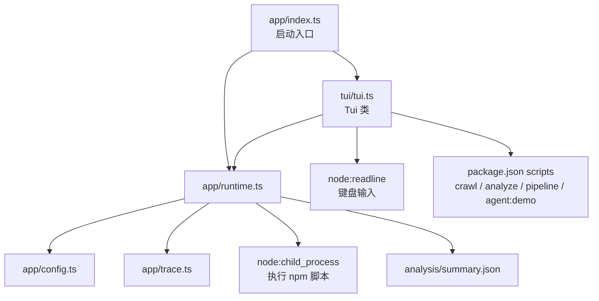

# TUI 模块说明

## 1. 模块定位

`src/app/tui` 是本项目的终端交互界面（Terminal UI，TUI）。它不直接实现爬虫、清洗或 Agent 逻辑，而是：

1. 展示当前数据摘要。
2. 提供菜单和键盘操作。
3. 通过子进程调用现有 npm 脚本。
4. 在操作完成后刷新摘要和状态。

这样 TUI 只是项目的控制面板，不会绕过原有爬虫和分析流程。

## 2. 文件结构

```text
src/app/
├── config.ts     # 环境变量与路径配置
├── index.ts      # 应用启动入口
├── prompt.ts     # Agent 提示词与默认任务
├── runtime.ts    # 摘要读取和 npm 脚本执行
├── trace.ts      # JSONL 运行追踪
└── tui/
    ├── index.ts  # 导出 Tui
    ├── tui.ts    # TUI 主逻辑
    ├── README.md # 使用说明
    └── tui.md    # 当前模块说明
```

## 3. 依赖关系



依赖方向是单向的：

```text
app/index.ts → tui/tui.ts → app/runtime.ts
                         → app/config.ts
                         → app/trace.ts
                         → analysis/summary.json
                         → npm scripts
```

`tui.ts` 不直接依赖具体爬虫模块、pandas 脚本或 Agent 内部实现。

## 4. 启动流程

```text
npm run tui
  → tsc 编译
  → node dist/src/app/index.js
  → new AppRuntime()
  → new Tui(runtime).start()
```

`start()` 会执行：

1. 检查 `process.stdin.isTTY`。
2. 非 TTY 环境打印静态菜单后退出。
3. TTY 环境进入备用屏幕、隐藏光标、开启 raw mode。
4. 监听键盘事件。
5. 读取 `analysis/summary.json`。
6. 渲染主界面。
7. 等待用户选择。

## 5. 界面内容

TUI 首页分为四个区域：

| 区域 | 内容 |
| --- | --- |
| 标题栏 | 项目名称和工作目录 |
| 数据摘要 | 图书数、平均评分、评价人数、最高分书、出版社 |
| 操作菜单 | 抓取、分析、流水线、Agent 演示、查看摘要、退出 |
| 状态栏 | 当前状态、最近命令输出 |

摘要读取失败时，界面会提示先执行清洗分析，不会导致 TUI 崩溃。

## 6. 键盘与菜单

| 按键 | 动作 |
| --- | --- |
| `1` | 执行 `npm run crawl` |
| `2` | 执行 `npm run analyze` |
| `3` | 执行 `npm run pipeline` |
| `4` | 执行 `npm run agent:demo` |
| `5` | 重新读取并显示摘要 |
| `q` / `Esc` | 退出 TUI |
| `Ctrl+C` | 强制退出 |

操作执行期间，`busy` 状态会阻止重复触发菜单操作；`Ctrl+C` 仍可退出。

## 7. 状态模型

`Tui` 类保存以下状态：

```ts
summary: Summary | null      // 当前摘要
status: string               // 状态栏文本
busy: boolean                // 是否有命令正在执行
lastOutput: string[]         // 最近命令输出
closed: boolean              // 是否已经退出
```

状态变化后统一调用 `render()` 重绘界面。

## 8. 命令执行流程

```text
用户按键
  → onKey()
  → 找到 MENU 项
  → runtime.runScript(script)
  → trace/start
  → execFile("npm", ["run", script])
  → trace/end 或 trace/error
  → 保存 stdout/stderr 最后若干行
  → refreshSummary()
  → render()
```

命令通过 `AppRuntime` 使用 `execFile` 执行，菜单脚本名来自固定 `MENU` 常量，避免接受任意用户命令。运行追踪写入 `data/app-traces/`。

## 9. 退出与清理

退出时会：

- 关闭 raw mode。
- 显示光标。
- 退出备用屏幕。
- 恢复标准终端输出。

这样不会把终端留在隐藏光标或全屏状态。

## 10. 扩展方式

新增菜单项时：

1. 在 `MENU` 中添加 `{ key, label, description, script }`。
2. 确保对应的 npm script 已存在。
3. 如果需要展示新数据，扩展 `Summary` 和 `readSummary()`。
4. 更新 `README.md` 和本文件。

示例：

```ts
{
  key: "6",
  label: "刷新看板",
  description: "重新生成 dashboard/index.html",
  script: "dashboard"
}
```

## 11. 设计边界

当前 TUI 不包含：

- 实时日志流。
- 鼠标交互。
- 多窗口布局。
- 后台任务队列。
- 命令取消和强制终止。
- 远程控制。

这些能力可以在后续通过事件总线、子进程管理和更完整的 TUI 框架实现。
